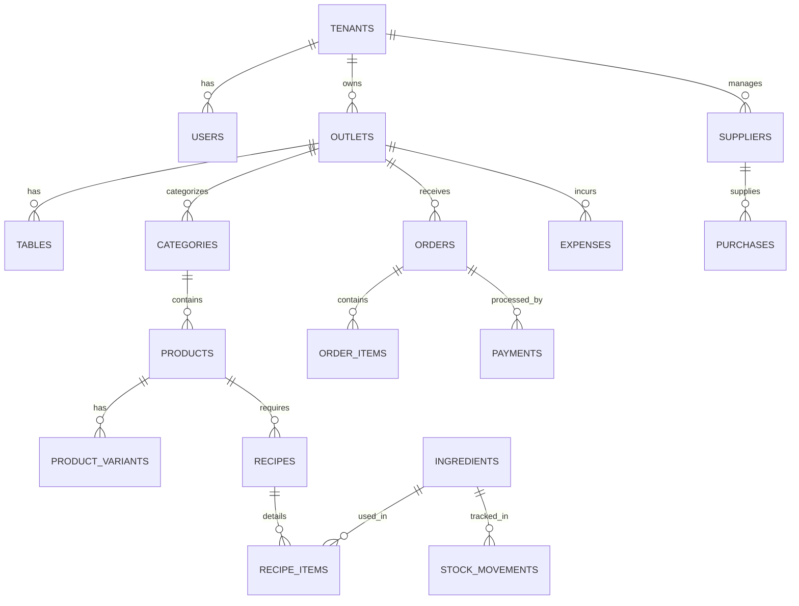

# DATA MODEL SPECIFICATION: CAFE MANAGEMENT SYSTEM

## 1. Konsep Desain Relasional & Multi-Tenancy
Setiap entitas bisnis memiliki kolom `tenant_id` yang terindeks untuk memastikan isolasi data antar kafe/tenant.

## 2. Entitas Utama

### A. SaaS & Akun
- **tenants**: `id (UUID/BIGINT PK)`, `name`, `subdomain/code`, `plan (FREE, PRO, ENTERPRISE)`, `status`, `created_at`
- **outlets**: `id PK`, `tenant_id FK`, `name`, `address`, `phone`, `receipt_header`, `receipt_footer`, `tax_percentage`, `service_charge_percentage`
- **users**: `id PK`, `tenant_id FK`, `outlet_id FK (nullable)`, `username`, `email`, `password_hash`, `role (OWNER, ADMIN, CASHIER, BARISTA)`, `is_active`

### B. Katalog Menu & Modifier
- **categories**: `id PK`, `tenant_id FK`, `name`, `sort_order`, `is_active`
- **products**: `id PK`, `tenant_id FK`, `category_id FK`, `name`, `sku/code`, `description`, `image_url`, `base_price`, `is_active`
- **product_variants**: `id PK`, `product_id FK`, `name (cth: Large, Hot)`, `price_adjustment`, `is_active`
- **modifiers**: `id PK`, `tenant_id FK`, `name (cth: Extra Shot, Sugar Level, Topping)`, `price`, `is_active`

### C. Meja & Transaksi POS
- **tables**: `id PK`, `outlet_id FK`, `number/name`, `capacity`, `status (AVAILABLE, OCCUPIED, RESERVED)`
- **orders**:
  - `id PK`, `tenant_id FK`, `outlet_id FK`, `order_number (unik harian/tahunan)`, `order_type (DINE_IN, TAKEAWAY)`
  - `table_id FK (nullable)`, `cashier_user_id FK`, `customer_name`
  - `subtotal`, `discount_amount`, `tax_amount`, `service_charge_amount`, `total_amount`
  - `status (PENDING_PAYMENT, PAID, IN_PREPARATION, READY, COMPLETED, CANCELLED)`
  - `created_at`, `updated_at`
- **order_items**:
  - `id PK`, `order_id FK`, `product_id FK`, `product_name_snapshot`, `variant_name_snapshot`
  - `unit_price_snapshot`, `quantity`, `subtotal`, `notes`
- **order_item_modifiers**:
  - `id PK`, `order_item_id FK`, `modifier_name_snapshot`, `price_snapshot`
- **payments**:
  - `id PK`, `tenant_id FK`, `order_id FK`, `payment_method (CASH, BANK_TRANSFER, QRIS, DEBIT)`
  - `amount_paid`, `change_amount`, `reference_number`, `status (SUCCESS, FAILED, REFUNDED)`, `paid_at`

### D. Inventori & Resep (BOM)
- **ingredients**: `id PK`, `tenant_id FK`, `name`, `unit (GRAM, ML, PCS)`, `cost_per_unit`, `minimum_stock`, `current_stock`
- **recipes**: `id PK`, `tenant_id FK`, `product_id FK (unique)`, `notes`
- **recipe_items**: `id PK`, `recipe_id FK`, `ingredient_id FK`, `quantity (cth: 18 untuk gram kopi, 150 untuk ml susu)`
- **stock_movements**:
  - `id PK`, `tenant_id FK`, `ingredient_id FK`, `movement_type (INITIAL, SALE, PURCHASE, ADJUSTMENT, SPOILED)`
  - `quantity_change (+/-)`, `stock_before`, `stock_after`, `reference_id`, `notes`, `created_by_user_id FK`, `created_at`

### E. Pembelian & Pengeluaran
- **suppliers**: `id PK`, `tenant_id FK`, `name`, `contact_person`, `phone`, `address`
- **purchases**: `id PK`, `tenant_id FK`, `supplier_id FK`, `invoice_number`, `total_amount`, `purchase_date`, `status`
- **purchase_items**: `id PK`, `purchase_id FK`, `ingredient_id FK`, `quantity`, `unit_cost`, `subtotal`
- **expense_categories**: `id PK`, `tenant_id FK`, `name`
- **expenses**: `id PK`, `tenant_id FK`, `category_id FK`, `amount`, `expense_date`, `description`, `receipt_image_url`, `recorded_by_user_id FK`

### F. Audit & Idempotensi
- **idempotency_keys**: `key (PK)`, `tenant_id`, `endpoint`, `response_payload`, `status_code`, `created_at`
- **audit_logs**: `id PK`, `tenant_id`, `user_id`, `action`, `resource`, `ip_address`, `details`, `created_at`
