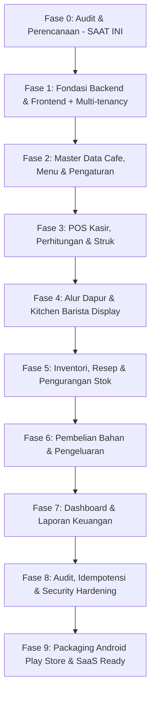

# IMPLEMENTATION PLAN: CAFE MANAGEMENT SYSTEM (PHASED ROADMAP)

## Roadmap Implementasi Bertahap

### Rincian Fase:

#### Fase 0 — Audit dan Perencanaan (Status: Dikerjakan)
- Audit lingkungan (Java 21, Maven 3.9, Node.js 26, PostgreSQL, Docker).
- Pembentukan baseline dokumentasi (`docs/` lengkap).
- Perancangan arsitektur SaaS multi-tenant & mobile packaging (Capacitor Android).
- Pengajuan persetujuan pengguna sebelum coding.

#### Fase 1 — Fondasi Sistem, PWA Offline-First & Hybrid Sync
- **Backend (Spring Boot):** Inisialisasi Spring Boot 3.3+ (Java 21 LTS, Maven), PostgreSQL connection, Flyway migrations (`V1__init_schema.sql`), Spring Security dengan JWT, Tenant & Outlet Interceptor, Global Exception Handling.
- **Frontend (PWA Offline-First):**
  - Setup React 18/19 + Vite + TypeScript + Tailwind CSS + Lucide Icons.
  - Setup PWA (Service Worker, Manifest PWA, offline asset caching).
  - Setup Local Database (IndexedDB via Dexie.js) untuk penyimpanan offline menu, pesanan, antrean transaksi.
  - Setup Sync Provider Engine: Interface sinkronisasi dengan 3 adapter:
    1. Spring Boot REST API Adapter
    2. Google Apps Script (GAS) Web App Adapter (Sheets Database)
    3. Dual Sync Adapter (Push ke Spring Boot & Google Apps Script)
  - Layout admin & kasir responsif mobile-first dengan Indikator Status Koneksi (Online / Offline / Syncing).

#### Fase 2 — Master Data Café, Multi-Outlet, Menu & Pengaturan
- CRUD Outlet & Cabang Kafe (Nama kafe, nama cabang, alamat, kontak, logo, footer struk, pajak %, service charge %).
- Switcher Outlet Aktif (mudah beralih cabang untuk Owner/Admin).
- Pengaturan Backend Sync (Pilihan: Spring Boot / Google Apps Script / Dual, input GAS Web App URL).
- Pengaturan Printer Kasir (Tipe koneksi: Bluetooth Web API / USB Serial / Browser Print, lebar kertas: 58mm / 80mm, auto-cut, tombol Test Print).
- CRUD Kategori Menu, Produk, Varian (Hot/Ice, Size), dan Modifier (Sugar level, extra shot).
- Manajemen Pengguna & Hak Akses per Outlet.
- Manajemen Meja per Outlet.

#### Fase 3 — Modul POS Kasir & Struk Digital / Termal Multifungsi
- Antarmuka Kasir cepat & responsif (katalog produk, tab kategori, dialog varian/modifier).
- Berjalan 100% offline (dapat melakukan transaksi tanpa sinyal internet).
- Keranjang belanja realtime & kalkulasi backend / offline engine (Subtotal, Diskon, Pajak/Service Charge, Total).
- Mode pesanan: Dine-In (pilih meja) atau Takeaway.
- Pembayaran: Tunai (otomatis kalkulasi kembalian), Transfer Bank, QRIS.
- **Koneksi Langsung Printer Termal (Web Direct ESC/POS):**
  - Cetak langsung ke Thermal Printer Bluetooth via Web Bluetooth API (`navigator.bluetooth`).
  - Cetak langsung ke Thermal Printer USB via Web Serial API (`navigator.serial`).
  - ESC/POS Command Generator (Format teks rata tengah, tebal, garis pemisah, total, barcode, auto paper cut).
- **Fitur Struk Pembelian Digital:**
  - Print / Download PDF struk dengan format profesional.
  - Salin Teks Struk ke Clipboard untuk dikirim ke chat/email.
  - Kirim Struk via WhatsApp langsung ke nomor pelanggan (`wa.me/?text=...`).
- Sinkronisasi transaksi otomatis ke antrean sinkronisasi (*Sync Queue*).

#### Fase 4 — Alur Pesanan & Kitchen/Barista Display
- Layar Display Pesanan untuk Barista / Dapur (KDS).
- Realtime polling / websocket status pesanan.
- Transisi status: `PAID` -> `IN_PREPARATION` -> `READY` -> `COMPLETED`.
- Kartu pesanan jelas dengan modifier khusus dan catatan barista.

#### Fase 5 — Inventori, Resep (BOM) & Pengurangan Stok Otomatis
- CRUD Bahan Baku dengan satuan standar (gram, ml, pcs) dan stok minimum.
- Setup Resep (Bill of Materials) per produk menu.
- Trigger atomik pengurangan stok otomatis saat pesanan berstatus `PAID`.
- Pencatatan log mutasi stok (*Stock Movement Trail*).
- Fitur Stock Opname dan penyesuaian stok rusak/waste.

#### Fase 6 — Pembelian Bahan & Pengeluaran Operasional
- Data Supplier dan Riwayat Pembelian Bahan Baku.
- Stok bertambah otomatis saat barang diterima (*Goods Received*).
- Pencatatan Pengeluaran Operasional (Kategori: Sewa, Listrik, Gaji, dll.).

#### Fase 7 — Dashboard & Laporan Keuangan
- Ringkasan metrik dashboard (Penjualan hari ini, pesanan aktif, produk terlaris, bahan menipis).
- Laporan Penjualan (Harian, Mingguan, Bulanan dengan filter kasir/metode bayar).
- Laporan HPP & Margin Produk.
- Laporan Laba Kotor dan Laba Bersih Sederhana (Omzet - HPP - Pengeluaran).
- Fitur Ekspor data (CSV / Excel).

#### Fase 8 — Penguatan Keamanan, Audit & Idempotensi
- Mekanisme Idempotensi transaksi POS untuk mencegah double-payment atau double-deduction stok jika koneksi terputus.
- Audit Log aktivitas pengguna.
- Security hardening (Rate limiting, sanitasi input, token refresh).

#### Fase 9 — Packaging Google Play Store & SaaS Onboarding
- Integrasi Capacitor Android ke dalam proyek frontend (`@capacitor/core`, `@capacitor/android`).
- Konfigurasi icon aplikasi, splash screen, build release APK / AAB.
- Integrasi dukungan Bluetooth Thermal Printer untuk Android.
- Halaman registrasi tenant mandiri (SaaS Onboarding) & switcher tenant.
